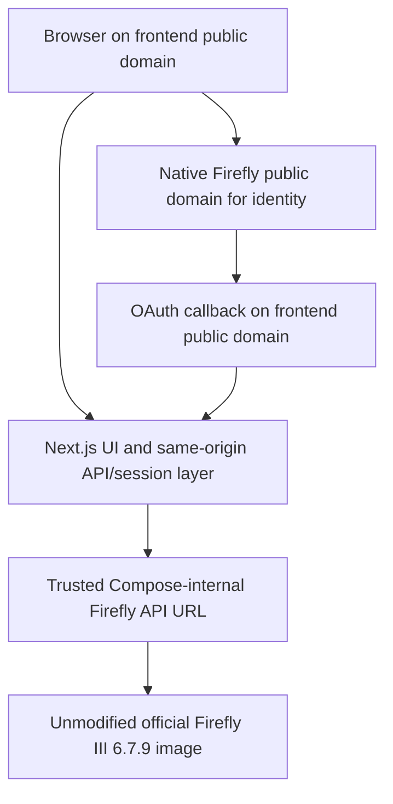

# Accepted architecture and immutable backend boundary

Decisions updated **2026-11-11** from the user's answers. Owner: FND-01 (decisions recorded, done); implementation belongs to remaining tasks. Application scaffold does not yet exist.

## Decision log

| ID | Decision | Accepted direction | State / unblocks |
| --- | --- | --- | --- |
| DEC-01 | Framework/deployment | Next.js App Router + React + strict TypeScript with Node server API/session layer. Frontend and original Firefly III are separate services in one Docker Compose deployment, with different public domains. Browser calls only its frontend origin; Node calls the trusted internal upstream. | accepted; FND-02/04/05 |
| DEC-02 | Backend modifications | **Forbidden.** Use the original official Docker image; no changes to source, extensions, patches, plugins, custom backend image, new backend endpoints, database shortcuts or HTML/session scraping. Local clone is read-only investigation evidence, not deployment input. | accepted constraint; all tasks |
| DEC-03 | Identity | Native Firefly login/registration/reset/MFA/profile/security/token/client management stay in native backend UI. Frontend connects using a personal access token or verified native OAuth flow and maintains its own secure per-user session. Do not rebuild identity. | accepted; FND-05/SYS-04 |
| DEC-04 | Version/language | Exact backend **6.7.9**, API URI v1, English UI only. Frontend release versions are directly backend-linked; see compatibility contract below. Other currencies/date formats remain supported; other translations/RTL certification are not release requirements. | accepted; FND-02/09/11, QA-03 |
| DEC-05 | Brand/design | **Firefly** name with supplied Verdelo visual style. Asset provenance/licenses still require publication review; rights were not explicitly confirmed. This does not block scaffold. | accepted brand; asset publication review under FND-03/QA-06 |
| DEC-06 | Repository/tool boundary | Existing independent Git repository at `frontend/` owns all new code/config/plans. Plans moved to `frontend/plans/`; sibling source/docs/design are read-only references. Data Importer remains a separate product; no new import engine. | accepted; FND-02/SYS-06 |

Actual public domain names, OAuth client secrets, image digest and local connection details are **deployment inputs**, not unresolved framework/scope decisions. Supply through environment/local secrets when testing; never invent production values or request private tokens in chat. No commits, branches, remote pushes or Git reinitialization unless separately requested.

## Deployment/data flow



Three explicit configuration concepts (names finalized by FND-02):
- **Frontend public URL**: HTTPS browser origin/callback base.
- **Backend public URL**: trusted native UI/authorization destination, accessible by the user's browser.
- **Backend internal API URL**: trusted Compose DNS/network address for server-to-server API/token requests, never sent to browser as a login URL.

Docker service connectivity does not mean shared browser origin or cookies. Do not copy/share/proxy Laravel session cookies into the frontend, assume credentialed CORS, or require cross-domain cookie changes on the immutable backend. Frontend owns HttpOnly secure cookie/session; native backend owns its authentication cookies. OAuth authorization uses the public backend URL; token exchange uses a verified reachable trusted endpoint, normally internal. Register exact public callback at backend; preserve canonical issuer/redirect requirements discovered in native flow. Compose/proxy settings use documented image environment only, no source patch.

Deliver Dockerfile/Compose example and deployment docs **inside the frontend repo**. Reuse user's same-stack topology; document how to merge example, do not overwrite a live Compose file or provision actual DNS/certificates. Pin the official backend image to a verified version tag and digest, not `latest` or an invented digest. Pin frontend Node/base image appropriately as well.

## Direct version coupling

Root [`backend-compatibility.json`](../backend-compatibility.json) is the machine-readable source of truth for exact backend target, source-inspection provenance, API URI generation and frontend release convention. It initially records unverified image tag/digest as null; this is an honest pre-implementation state, **not acceptable for production release**.

- Planned first package version: **`6.7.9-frontend.0.1.0`**; release tag convention **`v6.7.9-frontend.0.1.0`**. The `6.7.9` prefix always identifies the exact supported Firefly backend, `frontend.<major>.<minor>.<patch>` identifies frontend revisions. No tag or package has been created by planning.
- Package version, compatibility manifest, release docs, CI matrix and deployment image must agree. FND-02 owns initial enforcement; FND-09 owns contract provenance/drift and upgrade checklist; QA-05/06 verify release artifacts.
- Verify official registry release tag/digest and image runtime `/api/v1/about` version before production certification. The local source commit is an **inspection baseline**, not proof that a Docker digest was built from that exact commit. Diff actual image contracts without modifying image; record discrepancies.
- On connection and before enabling authenticated mutations, check runtime `version` equals **6.7.9**, not the unused legacy `api_version` setting or URI `v1`. Missing/unverifiable/mismatched version gives an English compatibility error and blocks financial reads/mutations until a successful explicit reconnect/verification; do not silently claim safe read compatibility. Health/native-auth/help and protected frontend session establishment/teardown (PAT connect/OAuth callback/disconnect) and compatibility recovery remain available. These exceptions may probe version/current-user as needed, but must not grant financial access on failed verification.
- Enforce the compatibility gate server-side on mutation routes too, with session-scoped verification state and bounded refresh; never trust only a hidden button or a client-supplied version. Clear on upstream/session change. Transient backend outages fail safely rather than accidentally open the gate.
- Upgrading backend is explicit work: new inspection/spec/image pin, inventories/contract tests, capability differences and frontend version-prefix update together. No broad semver range, auto-upgrade `latest`, bypass switch or speculative multi-version adapter.

## PAT and OAuth connection

**PAT is an accepted production connection method**, not merely temporary bootstrap. FND-05 implements a safe PAT connect form first: send token only in a same-origin protected POST, validate version/current user, keep credential server-side in a per-user session, clear input, and show disconnect/reconnect/revocation handling. Never put credentials in URL/localStorage/client bundle/logs. One user's token must not become the installation-wide token for every visitor. Expiration/revocation cannot silently trigger writes with another credential.

Native OAuth is the second accepted method, implemented against verified installed Passport capability (authorization code; PKCE if supported for selected client type). Keep confidential client secrets server-side, state/verifier one-time and return URLs allowlisted. Native Firefly renders its own login/consent/MFA/security screens; no custom password collection, password grant or replacement MFA/registration system. Backend public handoff and callback must work across the selected domains.

Frontend disconnect invalidates frontend session/cache; do not claim it logs out native backend or revokes a user-supplied PAT. Clearly separate optional verified token revocation from merely forgetting a credential. A request rejected as unauthorized can indicate permission failure as well as expired auth; don't loop refresh/logout blindly.

Choose a minimal safe server session implementation; no new Redis/DB dependency solely by habit. Document persistence/restarts/multi-replica needs and pick server storage or explicitly reviewed encrypted-cookie design. Tokens remain inaccessible to browser JS even when using encrypted session cookies; record threat/size/expiry constraints. Session rotation, CSRF/Origin protection, cookie scope and cache isolation are mandatory.

## Immutable-backend feature policy

- Implement current documented/existing API operations and proven compositions only. Backend accounting/auth/permissions remain authoritative.
- **Identity handoffs are approved scope**, with tested trusted links and English guidance; they are not missing new-design login/profile screens.
- Financial/report/reconciliation/helper gaps: FND-08 must classify source/runtime proof, safe API composition, unsupported/read-only state, or proposed native-UI fallback. Do not invent endpoints, recreate a second ledger, forward passwords/sessions or patch original source.
- A backend-native fallback for a **financial** workflow is not the same as native frontend parity and is not automatically approved just because identity handoffs are approved. Preserve inventory row, explain limitation, and seek user decision when no API composition is possible. Continue unrelated supported tasks instead of deadlocking the whole project.
- Task cards can split supported implementation from residual gap children. A supported parent/slice may finish with accurate evidence; unsupported original capability cannot be marked `verified`. Final capability report must distinguish full API coverage, native identity handoffs, source-broken API routes and residual financial gaps. No false full-parity release claim.
- Installer/upgrade/owner operational web-only actions remain on original image/native operational surfaces where required; record accessible handoff/proposed boundary rather than an arbitrary-command bridge. No backend modifications as a workaround.

## Organization and dependencies

Proposed layout, finalized by FND-02:

```text
frontend/
  AGENTS.md, MASTER-PROMPT.md, backend-compatibility.json
  plans/                      canonical task state, decisions, inventories, evidence
  src/app/                    Next routes/layouts/server handlers
  src/features/<domain>/      domain screens/API wrappers/local tests/nav manifests
  src/components/ui/          accessible supplied-design primitives
  src/lib/api/                allowlisted transport/codecs/contracts
  src/lib/auth/               PAT/OAuth sessions/CSRF/version gate
  src/lib/finance/            decimal/date/currency helpers, not an accounting engine
  src/lib/i18n/               minimal English messages/format-locale configuration
  src/styles/, public/        design-derived CSS and licensed assets
  tests/, docs/               fixtures, checks and deploy/setup documentation
```

Use current supported stable compatible Next/React/Node versions, pinned package lockfile, strict TS, minimal focused libraries (query, forms if justified, decimal, unit/browser/a11y tests). Avoid stock admin styling, speculative framework abstractions, a multilingual pipeline/RTL project or a new global store duplicating query data. Preserve existing repo/plans when scaffolding a non-empty directory.

## Transport, security and finance

- Fixed trusted upstream and allowlisted method/path. Reject arbitrary URLs, redirects and unsafe pagination URLs (SSRF/open proxy). Browser never selects arbitrary upstreams.
- Private fetches/responses `no-store`; no cross-user Next/CDN/in-flight cache. Query keys include session identity, administration/currency/date/filters and clear on disconnect.
- CSRF/Origin checks for frontend state changes; cron's side-effecting upstream GET is mediated by deliberate protected frontend POST, never prefetched/retried/probed automatically. Do not expose all-users static cron token.
- Timeout/abort, safe error normalization, 204 vs JSON/plain object/array/binary decoding, streamed downloads, upload limits, sanitized headers/filename/Markdown/notes. No automatic mutation retries or unproven Undo.
- Decimal-string financial values, currency-specific precision, separate native/foreign/primary amounts, date-only vs timestamp and explicit backend timezone/range rules. No cross-currency summing or Number accounting arithmetic. Group and journal IDs are different; complete retained split payloads prevent deletion.
- English user-visible copy. Language English doesn't force USD/two decimals or backend locale changes. Support currencies, accurate formatting and English regional format preferences as verified; no requirement to add Arabic/RTL or translation acquisition.
- No financial data/secrets in telemetry by default. No runtime third-party fonts/analytics/maps unless explicitly justified/approved. No real external notifications/webhooks or destructive production requests during testing.

## Validation boundary

Mocks prove client behavior only. Use a disposable **official pinned image** for contract/write testing, local sinks, isolated volumes and documented reset. Do not develop by installing/modifying cloned backend. Native UI may create test user/PAT/OAuth clients; documented image setup commands within isolated containers are allowed, code edits are not. Full release is the exact compatibility/capability report plus tested scoped UI, not a promise to change upstream deficiencies.
